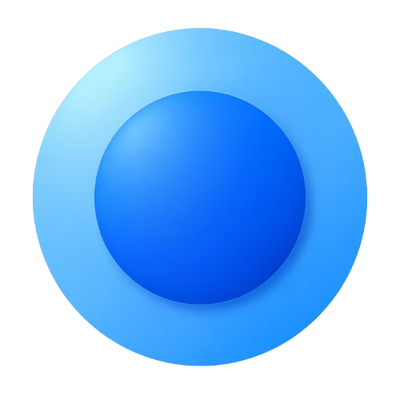

<p align="center">
  
</p>

<h1 align="center">LensAnywhere-Native</h1>

<p align="center">
  <b>Lightweight Windows visual search utility powered by Google Lens (Native C++20 Edition)</b>
</p>

<p align="center">
  <a href="https://github.com/aisthegoat/LensAnywhere-Native/releases"></a>
  <a href="LICENSE"></a>
  
  
</p>

---

## Overview

**LensAnywhere-Native** is an optimized fork of [utkarsh05kul/LensAnywhere-Desktop](https://github.com/utkarsh05kul/LensAnywhere-Desktop) by **Utkarsh Kulshrestha** (`@utkarsh05kul`).

It lets you capture any region of your Windows screen with a customizable global hotkey and instantly search it on **Google Lens** in your default browser — without browser extensions or external image hosting.

### Key Improvements in This Fork

- **Fixed Persistent Configuration (`%APPDATA%\LensAnywhere\settings.json`)**: Fixes the bug where settings and `onboarding_completed` were written inside PyInstaller's temporary `_MEI*` folder and lost on every launch.
- **Native C++20 Win32 + GDI+ Rewrite (`native/`)**: Removes the Python/PySide6 runtime and PyInstaller `--onefile` bootloader overhead:
  - **Idle RAM**: ~`2.2 MB` private memory (`< 1 MB` working set after trim) vs ~`87–110 MB` RSS in the original PySide6 build.
  - **Instant Startup**: No temporary extraction (`_MEI*`) on every launch; `cloudflared.exe` is cached once in `%LOCALAPPDATA%\LensAnywhere\`.
  - **Single Instance & Clean Lifecycle**: Named mutex prevents duplicate tray instances, and `cloudflared.exe` is bound to a Windows Job Object so it exits cleanly with the app.
- **Fixed Python Reference Version (`python/`)**: Keeps the original PySide6 implementation updated with persistent `%APPDATA%` config storage.

---

## Download

1. Open the **[Releases](https://github.com/aisthegoat/LensAnywhere-Native/releases)** page.
2. Download `LensAnywhere.exe`.
3. Run `LensAnywhere.exe` directly — no installation required.

---

## Features

- **Instant Region Cropping**: Per-monitor DPI-aware translucent overlay (`Shift+Alt+S` by default, customizable in Settings).
- **Direct Google Lens Search**: Serves captures from RAM over an ephemeral Cloudflare Tunnel (`trycloudflare.com`).
- **Clipboard & Auto-Save**: Optional automatic copy to clipboard (`CF_DIB`) and saving PNG captures to a chosen folder.
- **Background System Tray**: Minimal footprint with dark-themed Settings and Welcome windows built with native Win32/GDI+.

---

## Building the Native Edition (Windows)

### Prerequisites

- **MinGW-w64 / LLVM-MinGW** (`g++` with C++20 support and `windres`)
- Internet access on first build (to download `cloudflared-windows-amd64.exe`), or pass an existing `cloudflared.exe` via `-CloudflaredPath`

### Build

```powershell
powershell -NoProfile -ExecutionPolicy Bypass -File .\native\build.ps1
```

Or using an existing `cloudflared.exe`:

```powershell
powershell -NoProfile -ExecutionPolicy Bypass -File .\native\build.ps1 -CloudflaredPath "C:\path\to\cloudflared.exe"
```

The standalone executable will be created at `native\build\LensAnywhere.exe`.

---

## Running the Python Edition (Optional)

```powershell
cd python
pip install PySide6
# Place cloudflared.exe inside python\
python main3.py
```

---

## Configuration Location

Settings are stored persistently per user at:

```text
%APPDATA%\LensAnywhere\settings.json
```

The cached `cloudflared.exe` binary (for the native build) is extracted once to:

```text
%LOCALAPPDATA%\LensAnywhere\cloudflared.exe
```

---

## Privacy & Legal Disclaimer

- **Data Handling**: LensAnywhere does not upload or persist screenshots on third-party image hosts; captures stay in memory and are streamed locally through your ephemeral Cloudflare Tunnel directly to Google Lens.
- **Non-Affiliation**: Independent open-source utility, not affiliated with or endorsed by Google LLC. *Google Lens* is a trademark of Google LLC.

---

## Credits & License

- **Original Author & Design**: [Utkarsh Kulshrestha (@utkarsh05kul)](https://github.com/utkarsh05kul) — [utkarsh05kul/LensAnywhere-Desktop](https://github.com/utkarsh05kul/LensAnywhere-Desktop)
- **License**: [MIT License](LICENSE)
